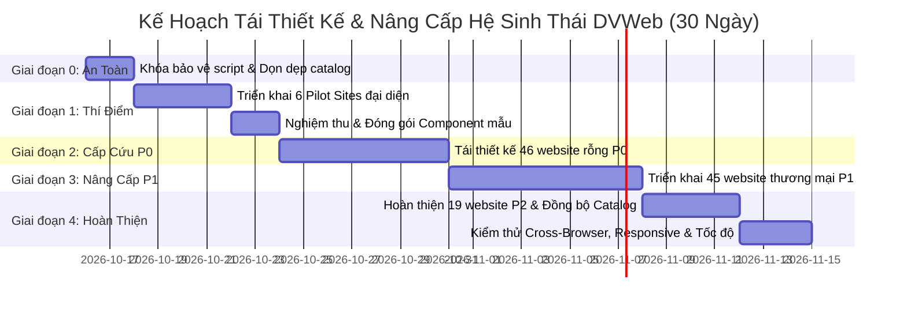

# LỘ TRÌNH TRIỂN KHAI TÁI THIẾT KẾ & BẢO TOÀN KIẾN TRÚC DVWEB
## Comprehensive Redesign Roadmap, Governance & Acceptance Criteria

**Dự án:** DVWeb — Website Template Marketplace & Demo Ecosystem  
**Tác giả:** Principal UI/UX Designer, Creative Director & Senior Frontend Architect  
**Phạm vi áp dụng:** 113 Demo Website, Bộ tạo tự động `tools/theme-discovery/`, và Marketplace Portal `index.html`  
**Ngày ban hành:** 15/10/2026  

---

## 1. Mục Tiêu Chiến Lược (Strategic Objectives)

Chuyển đổi toàn diện kho 113 demo website của DVWeb từ một tập hợp các bản sao sơ sài (110 site generic, 46 site rỗng tiêu đề) thành một **hệ sinh thái demo website thương mại cao cấp, đáng tin cậy và có cá tính thiết kế độc lập**.

### 3 Trọng Tâm Cốt Lõi:
1. **Khắc phục triệt để lỗi kỹ thuật (Zero Broken Shells):** Xóa bỏ 100% tình trạng tiêu đề rỗng `<h1></h1>`, thực đơn rỗng `<a></a>`, và lưới trống của 46 website nhóm P0.
2. **Đa dạng hóa thị giác & trải nghiệm (True Design Diversity):** Đưa 12 Archetype thiết kế vào từng ngành nghề cụ thể, đảm bảo sự khác biệt về thông tin, bố cục, nghệ thuật chữ và tương tác.
3. **Bảo tồn & Nâng cao tính chính trực (Demo Integrity & Safety):** Khóa an toàn chống ghi đè cho các website đã tùy biến; cung cấp tương tác frontend trung thực (giỏ hàng LocalStorage thật, thông báo minh bạch, không dùng `alert()` trình duyệt).

---

## 2. Kiến Trúc Bảo Vệ Chống Ghi Đè (Generator Overwrite Protection)

Hiện nay, hai script `tools/theme-discovery/build_sites.ps1` và `tools/theme-discovery/generate_local_sites.ps1` duyệt qua toàn bộ `data/themes.json` và sử dụng `WriteAllText` để ghi đè vô điều kiện lên `sites/<theme-id>/`. Điều này tạo ra rủi ro nghiêm trọng làm mất toàn bộ mã nguồn của các site đã hoàn thiện như `auto-garage-demo-40`, `cua-hang-hoa-demo-64`, `fashion-demo-01`.

### 2.1. Cơ chế Khóa Bảo Vệ 3 Lớp (Three-Tier Protection Guard)

1. **Lớp 1: Cấu trúc dữ liệu `data/protected_sites.json`:**
   Tạo tập tin lưu trữ danh sách các theme ID đã hoàn thiện kèm chữ ký băm (SHA-256) hoặc nhãn trạng thái `"designStatus": "custom-verified"`.
2. **Lớp 2: Kiểm tra tiền điều kiện trong Script (Pre-write Check):**
   Mọi script sinh mã phải bổ sung đoạn kiểm tra:
   ```powershell
   # tools/theme-discovery/build_sites.ps1 - Safe Guard
   $protected = Get-Content -Path "d:\dvweb\data\protected_sites.json" -Raw | ConvertFrom-Json
   if ($protected.Contains($t.id) -or $t.designStatus -eq "custom-verified") {
       Write-Host " [SKIPPED] Site $($t.id) is protected as bespoke design." -ForegroundColor Green
       continue
   }
   ```
3. **Lớp 3: Chế độ Dry-Run & Sao lưu tự động (Backup Snapshot):**
   Script tạo mã chỉ được ghi file khi có tham số `-Force` hoặc `-ApplyChanges`. Mặc định chạy ở chế độ khảo sát (Dry-run). Trước khi ghi đè, script tự động tạo thư mục backup tạm thời tại `scratch/backup_<timestamp>`.

---

## 3. Lựa Chọn & Đề Xuất 6 Website Thí Điểm (Pilot Sites)

Để chứng minh tính hiệu quả của 12 Archetype trước khi triển khai diện rộng, chúng tôi đề xuất **6 Website Thí Điểm đại diện cho 6 nhóm ngành trọng điểm**:

| Mã Theme | Theme ID | Ngành Nghề | Archetype Chỉ Định | Lý Do Lựa Chọn Thí Điểm |
| :---: | :--- | :--- | :--- | :--- |
| **#MS70** | `cong-ty-san-xuat-bao-bi-demo-70` | Doanh nghiệp B2B / Bao bì | **06. Corporate & Industrial B2B** | Đang bị lỗi rỗng P0. Cần xóa bỏ giỏ hàng, thay bằng form Yêu Cầu Báo Giá (RFQ) và bảng năng lực nhà máy ISO. |
| **#MS112** | `giao-duc-mam-non-demo-112` | Giáo dục mầm non | **08. Education & Academy Hub** | Đang bị lỗi rỗng P0. Cần thiết kế sinh động, thân thiện, lộ trình học Montessori và thực đơn dinh dưỡng. |
| **#MS48** | `landing-page-bat-dong-san-demo-48`| Bất động sản | **04. Architecture & Real Estate** | Đang bị lỗi rỗng P0. Cần mặt bằng kiến trúc 2D/3D, vị trí quy hoạch, form hẹn xem nhà mẫu. |
| **#MS54** | `website-tiem-cafe-tinh-demo-54` | Ẩm thực / Cà phê | **09. Culinary & Gastronomy** | Đang bị lỗi rỗng P0. Cần phong cách quán cafe ấm cúng, menu đồ uống tùy chỉnh đường/đá, đặt bàn nhóm. |
| **#MS111** | `website-nha-thuoc-sikido-demo-111` | Y tế / Dược phẩm | **07. Healthcare & Clinical Services** | Nhóm P1. Chuẩn hóa giao diện nhà thuốc đạt chuẩn GPP, tư vấn đơn thuốc minh bạch, không bán thuốc bừa bãi. |
| **#MS82** | `trung-tam-the-duc-the-hinh-demo-82` | Thể thao / Gym & Fitness | **08. Fitness & Active Lifestyle** | Đang bị lỗi rỗng P0. Bảng lịch tập tuần, gói hội viên VIP, profile Huấn luyện viên thể hình. |

---

## 4. Lộ Trình Triển Khai Chi Tiết Theo Giai Đoạn (Phased Roadmap)



---

### GIAI ĐOẠN 0: Thiết Lập Hàng Rào An Toàn & Chuẩn Hóa Dữ Liệu (Ngày 1 - 2)
- **Công việc trọng tâm:**
  1. Tạo `data/protected_sites.json` khóa 3 site đã hoàn thiện: `auto-garage-demo-40`, `cua-hang-hoa-demo-64`, `fashion-demo-01`.
  2. Bổ sung bộ lọc an toàn vào `build_sites.ps1` và `generate_local_sites.ps1`.
  3. Chuẩn hóa lỗi chính tả danh mục trong `data/themes.json` (hợp nhất `Khac` -> `Khác`, định danh đúng `Thực phẩm`, `Doanh nghiệp`, `Giáo dục`...).
  4. Bổ sung ảnh xem trước cục bộ cho 13 theme đang thiếu trong `assets/previews/`.
- **Sản phẩm bàn giao:** Bộ script sinh mã an toàn, dataset `themes.json` sạch 100%.

---

### GIAI ĐOẠN 1: Phát Triển & Đóng Gói 6 Website Thí Điểm (Ngày 3 - 6)
- **Công việc trọng tâm:**
  1. Xây dựng hoàn chỉnh 6 website thí điểm (`#MS70`, `#MS112`, `#MS48`, `#MS54`, `#MS111`, `#MS82`).
  2. Mỗi site áp dụng đúng Archetype, bảng màu, typography, trang con và tương tác đặc thù.
  3. Đóng gói các module tương tác dùng chung:
     - Module Giỏ hàng LocalStorage (`cart-store.js`).
     - Module Form gửi tư vấn & tích hợp Zalo (`inquiry-handler.js`).
     - Module Lọc & Tìm kiếm tức thì (`instant-filter.js`).
- **Sản phẩm bàn giao:** 6 website thí điểm đạt chuẩn thương mại cao cấp, bộ thư viện component mẫu.

---

### GIAI ĐOẠN 2: Cấp Cứu & Tái Thiết Kế 46 Website Rỗng Nhóm P0 (Ngày 7 - 13)
- **Công việc trọng tâm:**
  1. Xóa bỏ hoàn toàn hiện trạng `<h1></h1>` rỗng và lưới không có sản phẩm.
  2. Bổ sung dữ liệu ngành chuyên biệt cho 46 website theo ma trận đặc tả tại `reports/site-design-matrix.md`.
  3. Đảm bảo mọi website nhóm này có tối thiểu:
     - Trang chủ với khối Hero cá tính và 6-8 sản phẩm/dịch vụ đặc thù ngành.
     - Trang danh mục (`san-pham.html`) có bộ lọc cơ bản.
     - Trang giới thiệu (`gioi-thieu.html`) và liên hệ (`lien-he.html`).
- **Sản phẩm bàn giao:** 46 website P0 thoát khỏi tình trạng lỗi rỗng, hoạt động ổn định và đẹp mắt.

---

### GIAI ĐOẠN 3: Nâng Cấp 45 Website Nhóm P1 Thuộc Ngành Trọng Điểm (Ngày 14 - 21)
- **Công việc trọng tâm:**
  1. Phá vỡ sự trùng lặp 4 card generic trong các ngành: Thời trang, Mỹ phẩm, Công nghệ, Bất động sản, Nội thất, Ô tô.
  2. Thay thế dữ liệu mẫu giống nhau bằng dữ liệu đặc thù cho từng thương hiệu (ví dụ: shop veston nam khác với shop đầm dạ hội nữ; shop máy tính gaming khác với shop điện thoại).
  3. Cập nhật mã JavaScript `js/app.js` riêng biệt, loại bỏ lệnh `alert()` khó chịu, tích hợp giỏ hàng và form chuyên nghiệp.
- **Sản phẩm bàn giao:** 45 website P1 đạt chuẩn nhận diện thương hiệu độc lập.

---

### GIAI ĐOẠN 4: Hoàn Thiện Nhóm P2 & Đồng Bộ Toàn Diện Catalog (Ngày 22 - 25)
- **Công việc trọng tâm:**
  1. Tinh chỉnh 19 website thuộc nhóm ngành ngách (Thú cưng, Quà tặng, Gia dụng, Niche services).
  2. Cập nhật lại ảnh xem trước (previews) trên Marketplace `index.html` sao cho ảnh preview phản ánh đúng giao diện thật của từng website con sau khi tái thiết kế.
  3. Loại bỏ hoàn toàn sự vênh lệch giữa ảnh AI minh họa và giao diện thực tế.
- **Sản phẩm bàn giao:** 19 website P2 hoàn tất, Marketplace Portal đồng bộ 100%.

---

### GIAI ĐOẠN 5: Kiểm Thử Toàn Diện, Responsive & Nghiệm Thu (Ngày 26 - 30)
- **Công việc trọng tâm:**
  1. Kiểm thử hiển thị trên 4 mốc màn hình: Desktop (1920x1080, 1440x900), Laptop (1280x800), Tablet (768x1024), Mobile (375x667, 414x896).
  2. Kiểm tra tính toàn vẹn của thanh Return Bar (`../../index.html`) và liên kết hotline Zalo `0971183939`.
  3. Đo lường chỉ số Google Lighthouse (Performance >= 90, Accessibility >= 90, Best Practices >= 95, SEO >= 95).
- **Sản phẩm bàn giao:** Báo cáo nghiệm thu dự án toàn diện, sẵn sàng xuất bản lên GitHub Pages.

---

## 5. Tiêu Chuẩn Nghiệm Thu Cụ Thể (Concrete Acceptance Criteria)

Mỗi website trong số 113 demo phải vượt qua 5 cổng kiểm định chất lượng (Quality Gates) trước khi được đánh dấu hoàn thành:

### CỔNG 1: Tiêu Chuẩn Đa Dạng Thị Giác (Visual Diversity Gate)
- [ ] **Bố cục Hero khác biệt:** Website phải thuộc 1 trong 12 Archetype thiết kế đã định danh; không được sử dụng lại layout 1.1fr/0.9fr generic nếu không phù hợp ngành.
- [ ] **Bảng màu có tính nghệ thuật:** Sử dụng hệ biến màu sắc chuyên biệt (tối thiểu 5 token: Primary, Secondary, Background, Surface, Text), không dùng màu thô mặc định.
- [ ] **Typography có tính chủ đích:** Phải sử dụng font Google Fonts đã khai báo cho Archetype tương ứng (ví dụ: Serif cho thời trang/ẩm thực; Monospace/Tech Grotesk cho công nghệ; Sans-serif bo tròn cho mẹ & bé).
- [ ] **Không trùng lặp thẻ trong cùng ngành:** Hai website trong cùng một ngành phải có tối thiểu 3 đặc trưng thị giác khác nhau rõ rệt (kiểu bo góc, tỷ lệ ảnh, vị trí nhãn tag, hiệu ứng hover).

### CỔNG 2: Tiêu Chuẩn Hoàn Thiện Chức Năng (Functional Completeness Gate)
- [ ] **Đầy đủ hệ thống trang tối thiểu:** Phải có `index.html`, `san-pham.html`, `gioi-thieu.html`, `lien-he.html` liên kết thông suốt hai chiều.
- [ ] **Thanh Return Bar chuẩn mực:** Đầu mỗi trang phải có thanh thông báo chứa đúng mã `#MS...` và nút quay về `../../index.html`.
- [ ] **Không dùng Blocking Alert:** 100% các thao tác bấm nút "Thêm vào giỏ", "Xem chi tiết", "Gửi liên hệ" không được kích hoạt popup `window.alert()`.
- [ ] **Giỏ hàng hoạt động thật (Đối với E-Commerce):** Cho phép thêm sản phẩm, cập nhật số lượng trên header badge, lưu trữ `localStorage`, và có drawer/modal xem giỏ hàng.
- [ ] **Form liên hệ có xác thực:** Kiểm tra số điện thoại (10 chữ số), kiểm tra trường bắt buộc, có thông báo gửi thành công và nút mở chat Zalo trực tiếp.

### CỔNG 3: Tiêu Chuẩn Chất Lượng Nội Dung Tiếng Việt (Vietnamese Content Quality Gate)
- [ ] **Tiêu chuẩn ngôn ngữ tự nhiên:** Văn bản tiếng Việt mạch lạc, giàu tính thương mại, đúng thuật ngữ chuyên môn của ngành (ví dụ: ngành xe dùng "mã lực, mô-men xoắn, kiểm định 176 hạng mục"; ngành da liễu dùng "phục hồi màng ẩm, lành tính cho da nhạy cảm").
- [ ] **Không để sót placeholder:** Tuyệt đối không còn thẻ `{{TAGLINE}}`, `<h1></h1>` rỗng, `Lorem Ipsum`, hoặc nội dung chắp vá không nghĩa.
- [ ] **Định dạng tiền tệ chuẩn:** Mọi giá tiền phải định dạng theo chuẩn Việt Nam (ví dụ: `650.000₫`, `3.8 Tỷ`, `Liên hệ`).
- [ ] **Không lỗi font / Mojibake:** Đảm bảo 100% file lưu chuẩn mã hóa UTF-8 không lỗi ký tự.

### CỔNG 4: Tiêu Chuẩn Hiển Thị Di Động & Responsive (Mobile & Responsive Gate)
- [ ] **Menu di động thân thiện:** Trên màn hình dưới 768px, menu chính chuyển thành dạng Drawer hoặc Hamburger menu đóng mở mượt mà.
- [ ] **Lưới sản phẩm linh hoạt:** Lưới 4 cột trên desktop tự động co thành 2 cột trên tablet và 1-2 cột trên mobile, không bị tràn ngang (no horizontal overflow).
- [ ] **Kích thước vùng chạm cảm ứng:** Tất cả các nút bấm, icon và liên kết có diện tích chạm tối thiểu 44x44px theo chuẩn Accessibility WCAG.

### CỔNG 5: Tiêu Chuẩn Đạo Đức & Tính Chính Trực Demo (Truthful Demo Integrity Gate)
- [ ] **Minh bạch dữ liệu mẫu:** Không bịa đặt chứng chỉ quốc tế giả hoặc lịch sử thương hiệu lừa dối. Các số liệu minh họa phải có nhãn rõ ràng hoặc mang tính chất trình diễn giao diện.
- [ ] **Thông báo gửi liên hệ trung thực:** Khi gửi form liên hệ qua môi trường tĩnh GitHub Pages, hộp thoại xác nhận phải nêu rõ: *"Cảm ơn quý khách đã gửi thông tin trải nghiệm demo. Để được phản hồi nhanh nhất, vui lòng liên hệ trực tiếp Zalo: 0971183939."* kèm nút chuyển sang Zalo.
- [ ] **Đồng bộ ảnh Preview:** Hình ảnh preview trên trang chủ marketplace `index.html` phải là ảnh chụp thật của website con hoặc thể hiện đúng tinh thần bố cục của giao diện, loại bỏ việc dùng ảnh AI vẽ viễn vông để lừa dối người xem.

---

## 6. Kế Hoạch Duy Trì & Quản Trị Hệ Thống (Governance & Maintenance)

1. **Quản lý phiên bản dữ liệu:** Mọi cập nhật thông tin theme phải được commit kèm mã SHA kiểm tra tính toàn vẹn của cả `data/themes.json` và `js/themes-data.js`.
2. **Kiểm thử tự động trước khi triển khai (Pre-deploy Verification):**
   - Viết script `tools/test_validation.ps1` chạy tự động kiểm tra: 0 file rỗng H1, 0 file thiếu Return Bar, 0 file lỗi font tiếng Việt, 0 liên kết ngoài bị hỏng.
3. **Phân quyền can thiệp mã nguồn:**
   - Thư mục `sites/` chỉ được chỉnh sửa thông qua quy trình phát triển giao diện bespoke.
   - Thư mục `tools/` chỉ dùng để bảo trì dữ liệu, không được chạy script sinh mã đè lên `sites/` khi chưa có phê duyệt từ Senior Frontend Architect.
